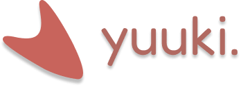
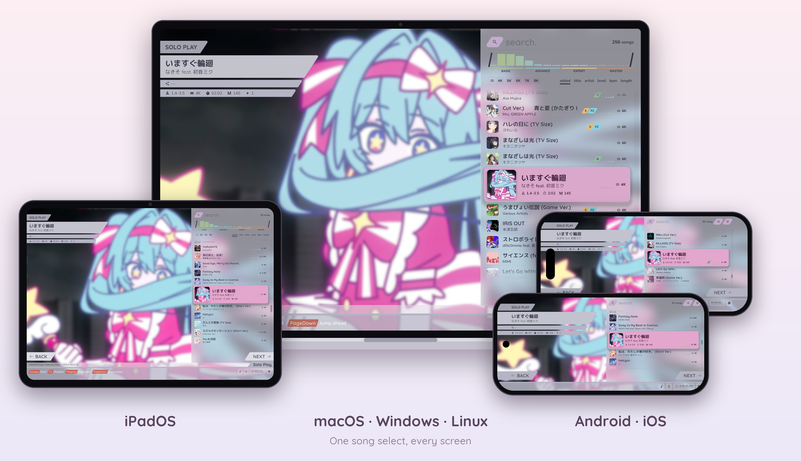

# yuuki.

Another rhythm game(?) create using [Sakura Framework](https://github.com/HelloYeew/sakura). Mainly it's my Sakura testbed and performance test for framework too but it's playable so...🐒



## Requirements

- .NET 10.0 SDK for the desktop game and the tests
- .NET 11.0 SDK (RC 2 for now) for phones and tablets, with its workloads: `dotnet workload install android` and `dotnet workload install ios`
- Android: the Android SDK and JDK 21 (`brew install openjdk@21` on a Mac)
- iOS and iPadOS: a Mac with Xcode 27, and an Apple Development certificate with a provisioning profile. A free Apple account works, but its profiles only last 7 days.
- We recommend to use IDE like [Visual Studio](https://visualstudio.microsoft.com/vs/), [Rider](https://www.jetbrains.com/rider/) or [VS Code](https://code.visualstudio.com/) for development

## Run the game 👍

```shell
git clone https://github.com/HelloYeew/yuuki
cd yuuki

# Run the game (macOS, Windows, Linux)
dotnet run --project Yuuki.Game.Desktop

# Run visual test
dotnet run --project Yuuki.Game.Tests

# Run the tests headless
dotnet test Yuuki.Game.Tests
```

### Android

With a phone (USB debugging on) or an emulator connected:

```shell
dotnet build Yuuki.Game.Android -t:Install -p:JavaSdkDirectory=/opt/homebrew/opt/openjdk@21/libexec/openjdk.jdk/Contents/Home
```

A Debug build keeps its assemblies on the device instead of in the APK, so install it with `-t:Install` as above: the APK alone won't start.

### iPhone and iPad

```shell
dotnet build Yuuki.Game.iOS -c Release -r ios-arm64

# Find the device, then install and start the game on it
xcrun devicectl list devices
xcrun devicectl device install app --device <UDID> Yuuki.Game.iOS/bin/Release/net11.0-ios/ios-arm64/Yuuki.Game.iOS.app
xcrun devicectl device process launch --device <UDID> dev.helloyeew.yuuki
```

For the simulator, build with `-r iossimulator-arm64` and install with `xcrun simctl install booted Yuuki.Game.iOS/bin/Debug/net11.0-ios/iossimulator-arm64/Yuuki.Game.iOS.app`.

Installing over the game keeps its songs, scores and settings. With the phone plugged into a Mac, the game's folder shows in Finder's Files tab: drop `.osz` files into it and they're imported the next time the game starts or comes back to the front.

## Release builds

```shell
dotnet tool install -g vpk
sh release.sh [patch]
```

This builds macOS, Windows, Linux (packaged with [Velopack](https://velopack.io)) and Android into `Releases/`, versioned `YYYY.MDD.PATCH` by today's date in Bangkok time. The Android build is signed with your keystore when `ANDROID_KEYSTORE`, `ANDROID_KEY_ALIAS` and `ANDROID_KEYSTORE_PASSWORD` are set, otherwise with the debug key, which is fine to try but not to ship.

The iPhone build isn't in `release.sh` yet. To give it the same version, add `-p:Version=<version> -p:ApplicationDisplayVersion=<version> -p:ApplicationVersion=<version>` to its build.

## Checkout local framework

Make sure you have cloned the Sakura Framework repository and build it first at the same root folder of this repository.

```shell
sh UseLocalFramework.sh
```

The framework is built in Release so performance matches the published package, even when the game runs in Debug. Use `sh UseLocalFramework.sh Debug` to step through framework code instead.

To go back to the published package, undo the `.csproj` changes the script made. After switching either way, delete the phone projects' `obj/Release` and `bin/Release`: the iOS build trips over what the other one left there.

## Contributing

Just no slop pls man

## License

This project is licensed under the MIT license. Please see [the license file](LICENSE) for more information. tl;dr you can do whatever you want as long as you include the original copyright and license notice in any copy of the software/source.
